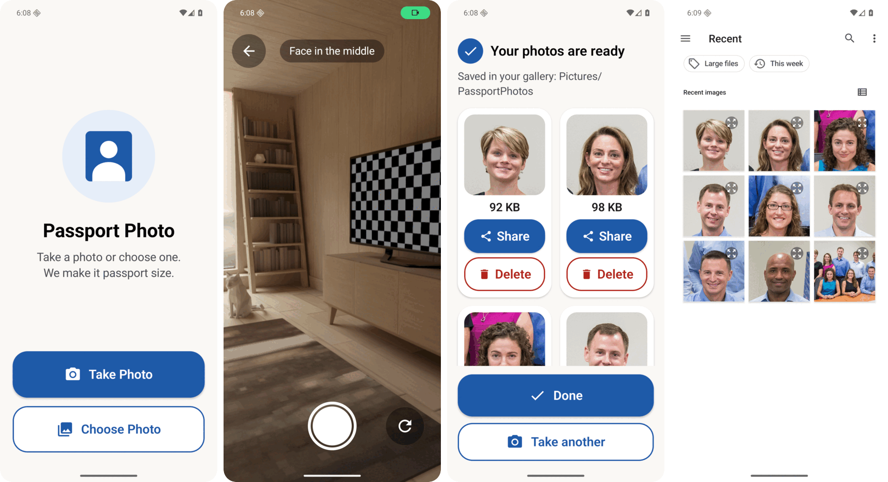

# Passport Photo

[](https://github.com/Anuraj-dev/passportcam/actions/workflows/ci.yml)
[](https://github.com/Anuraj-dev/passportcam/releases/latest)
[](LICENSE)

Take a photo, or pick one, and get a passport-style square picture of every face in it, each **under 100 KB**. Everything happens on the phone. Nothing is uploaded.



*Left to right: home, camera, results for a group photo, and the saved photos in the system file picker's Recent tab. Group photo: NASA astronaut group 21 (public domain).*

## What it does

- **Take Photo** opens a camera that works like the phone's own (flip, tap to focus). **Choose Photo** picks one from the gallery.
- Finds every face and cuts one **51 × 51 mm** square (600 × 600 px) per person, the India passport size. Group photos give one picture per face.
- Every JPEG is **strictly under 100,000 bytes**. Quality drops first (95 down to 60), and the picture shrinks (600, 500, 413 px) only if that is not enough.
- Keeps the original background.
- Saves to `Pictures/PassportPhotos`, so the pictures show up in any file picker's **Recent** list, ready to upload on a government site.
- Built for people who rarely use phones: huge buttons, a few words, one obvious action per screen, no settings.
- Tiny faces in the background (under 120 px) are skipped, and the app says so.

## Install

1. Download `PassportPhoto-vX.Y.Z.apk` from the [latest release](https://github.com/Anuraj-dev/passportcam/releases/latest).
2. Open it on the phone and allow "install unknown apps" when asked.
3. Optional: check the download against the `.sha256` file from the same release.

Requires Android 8.0 (API 26) or newer. The release APK is signed with a key that is not the debug key, so a debug build must be uninstalled before installing a release.

## Privacy

Face detection is ML Kit's bundled on-device model. The app has **no network access, no analytics**, and asks only for the **camera** permission (the photo picker needs none).

## How it works

```
photo (camera or gallery)
  -> ImageLoader      decode, apply EXIF rotation, cap at 4096 px
  -> FaceDetector     ML Kit, accurate mode
  -> PassportCropper  square around each face, head ~74% of the frame, room for shoulders
  -> Compressor       binary-search JPEG quality; shrink the side if still too big
  -> PhotoSaver       MediaStore: Pictures/PassportPhotos
```

All tunables (size cap, sizes, quality range, minimum face size) live in [`Config.kt`](app/src/main/java/dev/raja/passportcam/core/Config.kt).

## Build

Needs JDK 21 and the Android SDK (compileSdk 37).

```sh
./gradlew :app:testDebugUnitTest      # unit tests
./gradlew :app:assembleDebug          # app/build/outputs/apk/debug/app-debug.apk
adb install -r app/build/outputs/apk/debug/app-debug.apk
adb logcat -s PassportCam             # every pipeline step is logged
```

Release builds are signed from environment variables, and the keystore is never in the repo:

```sh
PASSPORTCAM_KEYSTORE=/path/to/release.jks \
PASSPORTCAM_KEYSTORE_PASSWORD=... \
./gradlew :app:assembleRelease
```

## Releasing

Bump `versionName` and `versionCode` in `app/build.gradle.kts`, then push a matching tag:

```sh
git tag v1.0.1 && git push origin v1.0.1
```

The [Release workflow](.github/workflows/release.yml) runs the tests, builds and signs the APK, verifies the signature, and publishes it with a SHA-256 file. It needs two repository secrets: `KEYSTORE_BASE64` (the keystore, base64-encoded) and `KEYSTORE_PASSWORD`.

## Stack

Kotlin, Jetpack Compose (Material 3), CameraX, ML Kit Face Detection, ExifInterface, MediaStore.

## License

[MIT](LICENSE)
